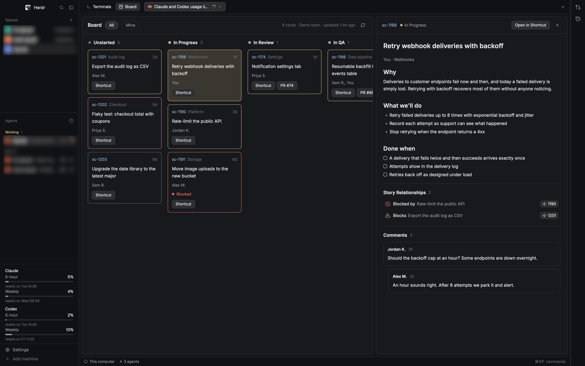

# Board Desk for Herdr

A [Herdr](https://herdr.dev) layout for working with coding agents and a Shortcut board side by side.

- **Terminals / Board switch** left of the tab bar: swap the main area between your terminals and your Shortcut team's kanban board.
- **Story pane**: click a card to read its description, relationships and comments next to the board (read-only).
- **Usage panel**: CPU, RAM and GPU gauges and Claude and Codex 5-hour and weekly plan limits at the bottom of the sidebar.
- **Right rail**: your open GitHub pull requests and your past Claude Code and Codex sessions for the focused repo; child terminals get their own pane.

## Install

Ask the agent in your Herdr window to add it:

> Add the Herdr layout from https://github.com/klindic/herdr-board-desk

Or by hand: copy `layouts/board-desk.json` into `~/.config/herdr-app/layouts/` and each folder in `mods/` into `~/.config/herdr-app/mods/` (rename any that clash with mods you already have), then switch with `ctrl-shift-l`. Restart Herdr once so the bundled Inter font loads.

## Configure

- **Board**: copy `mods/shortcut-board/config.example.json` to `config.json` and set your `team` (name, mention name or id) and the `columns` (workflow state names) to show. Put your Shortcut API token in `$SHORTCUT_API_TOKEN` or in the file `token_file` points at. Set `"demo": true` to try it with made-up stories.
- **Pull requests** (optional): copy `mods/my-prs/config.example.json` to `config.json` and set `org` to search one GitHub organization only. Needs `gh` signed in.
- **Usage panel**: nothing to set. It reads the logins Claude Code (macOS keychain) and Codex (`~/.codex/auth.json`) already have.

## What it touches

Before installing, know that these mods run programs and reach the network: the board calls the Shortcut API; the usage panel calls Anthropic's and OpenAI's usage endpoints with your existing Claude Code and Codex tokens (read-only, never refreshed); Pull requests runs `gh`; Sessions reads `~/.claude` and `~/.codex` and can move a session file to the Trash.

`RECIPE.md` describes the whole layout in enough detail to rebuild it from scratch.

## License

MIT, see `LICENSE`. The usage panel's look is adapted from [chelebyy/herdr-agent-workspace](https://github.com/chelebyy/herdr-agent-workspace) (Apache 2.0) and [Lakris2407/herdr-quota](https://github.com/Lakris2407/herdr-quota) (MIT); the bundled Inter font is under the SIL Open Font License. See `NOTICE`.
