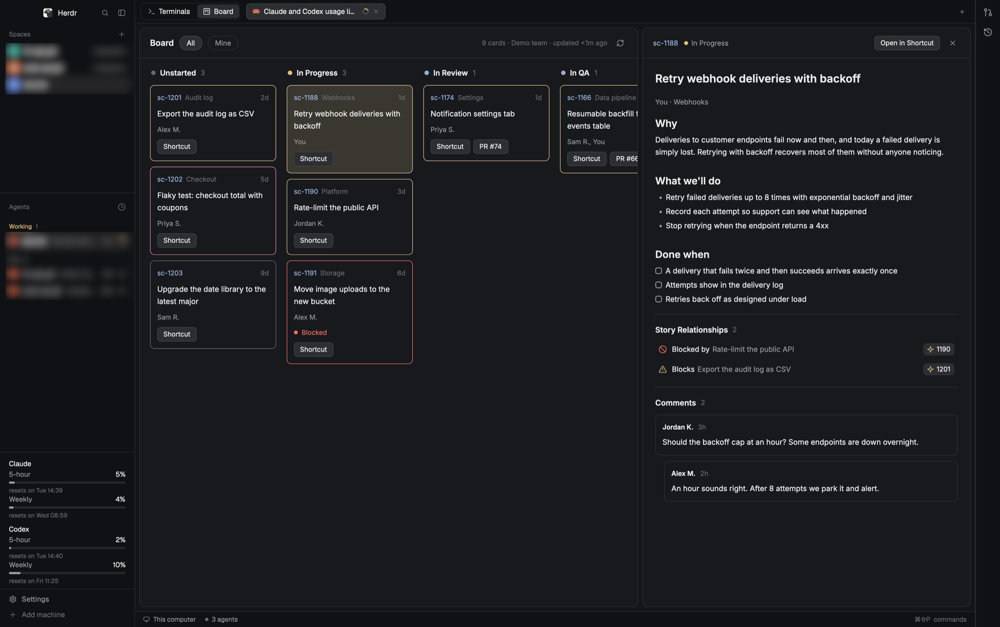

# Board Desk

Herdr's main layout, reworked for a day of agents and tickets. A Terminals / Board switch sits left of the tab bar: Terminals shows the active tab's panes as usual, Board swaps the whole main area for your Shortcut team's kanban board, and clicking a card opens the story (description, relationships, read-only comments) beside it. The left sidebar ends with live Claude and Codex plan limits (5-hour and weekly). On the right, an icon rail toggles a panel with your open GitHub pull requests or your past Claude Code and Codex sessions for the focused repo.

## What you see

Left to right:

1. **Sidebar** (268px, `chrome`): the Herdr brand row (46px), the spaces list and the agents list (equal shares, 90px minimum each), the **usage panel**, then Settings and Add machine (69px).
   - Usage panel: a 1px top border, 16px side padding. Two sections, **Claude** and **Codex**, each a semibold 13px title and one row per window: the label (`5-hour`, `Weekly`) in `muted` on the left, the percentage semibold in `foreground` on the right, a 4px rounded bar below (track `border`, fill `muted`, fill `blocked` at 90% or more) and `resets on Tue 14:39` in 11px `dim`. The block sizes itself to fit: 18px padding + 20px per title + 45px per window, 8px between sections. A section that can't load shows one dim line instead (`not signed in to Claude Code`, `token expired, open Claude Code to refresh`). If a refresh fails but numbers were loaded before, the old numbers stay up with a small red dot by the title. With the sidebar folded to its rail (under 160px) each tool becomes a 36px tile: two letters (`Cl`, `Co`) over its highest percentage, details in the tooltip.
2. **Work column**:
   - **Top bar** (42px, one 1px bottom border across its whole width): the **view switch** (190px) then Herdr's tab bar. The switch is a 31px segmented control (8px radius, 1px `border`, 2px padding) with two 25px segments, `>_ Terminals` and a kanban icon with `Board`, 12.8px text; the active segment is `raised` with `foreground` text, the other `muted`. A 1px by 18px `border` divider follows it.
   - **Main view** (8px padding): a stack of the active tab (panes as 10px-radius cards with Herdr's `pane` header, 8px gap) and the **board**.
   - Herdr's Files / Changes panel (hidden by default) and the status bar (28px).
3. **Right panel** (300px, `chrome`): a stack of **Pull requests** and **Sessions**.
4. **Right rail** (44px, `chrome`, 1px left border): 32px icon buttons for Pull requests and Sessions; the shown one is `selected`. Pull requests carries an `accent` badge with the number of PRs waiting for your review.

### The board

All text on the board uses **Inter** (Shortcut's own font), bundled in `mods/shortcut-board/fonts`.

- A card with a 1px `border` and 10px radius on `background`. **Header** (54px, bottom border): `Board` (15px semibold), `All` / `Mine` filter chips (26px pills, the active one `raised` with an `input` border), then right-aligned `9 cards · Team name · updated 2m ago` (12px `dim`, `blocked` when it is an error) and a refresh button that spins while loading.
- **Columns**: one per configured workflow state, side by side with 4px gaps and 18px side padding, scrolling sideways when they don't fit. A column is 220 to 380px wide, sized from the full board width (so opening a story never resizes cards). Each starts with an 8px state dot, the state name (13.5px semibold) and the card count (`dim`). Dot colors: Unstarted `idle`, In Progress `working`, In Review `ansi4`, In QA `ansi5`, PO Acceptance `ansi6`, Accepted `done`; other states go by type (unstarted, started, done).
- **Cards** (12px padding, 8px gap, 8px radius, `surface`): `sc-1188` in `ansi4`, the epic in `dim` (truncated) and the age since it last moved (`3d`) on one line; the title in 13.5px `foreground`, wrapping, cut at 140 characters; the owners' short names (`Alex M., Sam R.`) or `No owner` in `muted`; a red `Blocked` (or `Blocking another story`) line when it applies; then `Shortcut` and one `PR #n` button per linked GitHub PR (26px, `raised`, 1px `border`).
- **Card border** is the story's color: `blocked` when blocked, else by type: feature `ansi3`, bug `ansi1`, chore `dim`. Hovering changes nothing. The selected card keeps its border and fills with that color at alpha `2e`.
- **Scrolling**: each column scrolls on its own. The scrollbar is drawn by the mod: a 6px rounded pill in `muted` at 45% opacity, 3px from the edge in a 15px gutter right of the cards, fading in while scrolling and out 0.9s after.

### The story pane

Clicking a card splits the board 60/40 with an 8px gap: the board card on the left, a second bordered 10px-radius card on the right.

- **Header** (54px): `sc-1188`, the state's dot and name, a spinner while loading, `Open in Shortcut` and a close button.
- **Body** (22px side padding, 16px gaps), scrolling with the same rounded thumb: the title (20px semibold), owners · epic (12.5px `muted`), the description rendered as Markdown (headings, lists, task checkboxes, code, links; bare `sc-123` references become Shortcut links), **Story Relationships** and **Comments**.
- **Story Relationships**: a 1px top rule, `Story Relationships` and its count, then a 32px row per link: an icon (`Blocked by`: a ban sign in `blocked`; `Blocks`: a warning triangle in `ansi3`; `Duplicates` / `Duplicated by`: a copy icon; `Relates to`: a link icon), the relationship in `foreground`, the other story's title in `muted` (`dim` once finished), and on the right a 22px `raised` chip with the story type icon (feature sparkle, bug, chore wrench) and its number. `No relationships` when there are none.
- **Comments**: oldest first, each a `surface` card with a 1px `border`: the author semibold and the age in `dim`, then the text as Markdown. Replies are indented 16px. Read-only: there is no way to post. `No comments` when there are none.

### Pull requests and Sessions

- **Pull requests**: 42px header (`Pull requests`, the focused terminal's repo name, `updated 2m ago`, a refresh button), then **Mine** and **Review requested** for that repo only. Each row: a 7px CI dot (`done` passing, `blocked` failing, `working` pending), the title, `repo #123`, `draft` or the review state, and the age. Clicking opens it in the browser. Outside a GitHub repo it says so.
- **Sessions**: Claude Code and Codex sessions started in the focused repo, newest first, grouped under Today, Yesterday, This week, This month and Older, each with its program icon, title (the first prompt) and age; a running one says `running, click to show`. Clicking a running session focuses its terminal; clicking an old one resumes it in a new tab. Each row's `⋯` opens a small popup with **Copy session ID** and **Move to Trash** (confirmed; running Claude sessions can't be moved).

## How it behaves

- **Agent status** comes from Herdr's own agents list and tab bar (shipped mods): working spins, blocked and done show a dot, idle is plain.
- **View switch**: clicking a segment selects that child of the `main-view` stack (`layout.select`). Terminals keep running behind the board and come back as they were.
- **Board**: refreshes every 2 minutes and on the refresh button; the last board shows at once on start (kept in `localStorage`). `Mine` shows only cards you own. Clicking a card selects it and opens the story; clicking the selected card again does nothing; clicking anywhere else on the board (not a card, not the story pane) closes it; the close button closes it too. Clicking a relationship row opens that story. `Shortcut`, `PR #n`, `Open in Shortcut` and links in descriptions open the browser. A story is fetched when opened and reused for a minute.
- **Usage panel**: refreshes every 3 minutes; clicking a section refreshes now.
- **Pull requests**: refreshes every 2 minutes and follows the focused terminal's repo. It posts a notification when one of your PRs is approved, gets changes requested, or its checks fail.
- **Right rail**: clicking an icon shows its view in the right panel; clicking the shown one hides the panel. It also gives every new child terminal (one with a parent, such as `hc run --bg`) its own pane: the first child of a parent opens right of it, later siblings stack below, and focus goes back to where it was.

## Built from

- **Layout** `layouts/board-desk.json`, cloned from Herdr's `main`: root row of `sidebar` (column: `brand` block `workspace-chrome`; `sidebar-lists` column of `spaces` and `agents`; `usage` block `usage-limits`; `sidebar-footer` block `workspace-chrome` with props `{footer: true}`), `work` (column: `top-bar` row of `view-switch` and `tabs`; `work-body` row of the `main-view` stack (`main`: `{tab: "active"}` with the `pane` header; `board`: `shortcut-board`) and the hidden `panel` stack of `files` / `changes`; `status` block `workspace-status`), `right-panel` (stack `right-views` of `prs`: `my-prs` and `sessions`: `sessions`) and `right-rail`.
- **Shipped mods used**: `workspace-chrome`, `spaces`, `agents`, `tabs`, `pane`, `files`, `changes`, `workspace-status`.
- **`usage-limits`**: runs `fetch_usage.py`, which reads Claude Code's OAuth token from the macOS keychain (`Claude Code-credentials`) and calls `https://api.anthropic.com/api/oauth/usage` (`five_hour`, `seven_day`), and reads `~/.codex/auth.json` and calls `https://chatgpt.com/backend-api/wham/usage` (primary and secondary windows), falling back to the rate limits in the newest `~/.codex/sessions/**/rollout-*.jsonl`. Tokens are only read, never refreshed. Resizes its own block with `layout.resize`.
- **`view-switch`**: reads `layout()` for the stack's active child, `layout.select`, and `layout.resize` to make room for the macOS traffic lights when the sidebar is folded.
- **`shortcut-board`**: runs `fetch_board.py` (board) and `fetch_board.py story <id>` (one story) against the Shortcut REST API v3 (`/groups`, `/workflows`, `/stories/search`, `/stories/{id}`, `/members`, `/epics/{id}`, `/member`). Settings in `config.json` (see `config.example.json`): `team` (name, mention name or id), `columns` (state names, in order; default every non-backlog state), `token_file` (bare token or a `SHORTCUT_API_TOKEN=` line), `demo` (made-up stories, no network). `$SHORTCUT_API_TOKEN` wins over `token_file`. Team, workflow, member and epic names are cached for a day in `~/.cache/herdr-shortcut-board.json`. Markdown through `TextView.markdown`. Bundles Inter (SIL Open Font License) and Lucide-style SVG icons.
- **`my-prs`**: `gh api graphql` search for open PRs authored by you and requesting your review; `git remote get-url origin` for the focused repo; `notify` for changes; sets shared `prs.badge`. Optional `config.json` `{"org": "..."}` limits the search to one GitHub organization.
- **`sessions`** and **`session-actions`**: `list_sessions.py` reads `~/.claude/projects`, `~/.claude/sessions`, `~/.codex/sessions` and `~/.codex/session_index.jsonl` (head and tail of each file, cached in `~/.cache/herdr-sessions.json`); resuming uses `tab.new` with `claude --resume <id>` or `codex --no-daemon resume <id>`. `trash_session.py` moves one session file to `~/.Trash/Herdr Sessions`.
- **`right-rail`**: `layout.select` / `layout.show` / `layout.hide` on `right-panel`; `auto-tile.js` watches `terminals()` and uses `terminal.keep` and `pane.focus`.

## Watch out

- The board needs `config.json` with a `team`, and a Shortcut API token (Settings, API Tokens in Shortcut). Without them it shows what is missing; set `"demo": true` to try it first.
- Herdr loads bundled fonts at start and on the next look change; after adding the mod, restart Herdr (or change the theme once) or the board falls back to the system font.
- The usage panel reads the macOS keychain, so on Linux and Windows the Claude section shows `not signed in`. Codex works anywhere `~/.codex/auth.json` exists. These are undocumented endpoints and may change.
- Pull requests needs `gh` signed in; Sessions moves files to the macOS Trash.
- Herdr's built-in scrollbar can't be styled, so the board's columns and the story pane scroll themselves (`on_scroll_wheel`, content moved with a negative `top`) to draw a rounded thumb. The sideways scrollbar under the columns is still Herdr's.
- Sizes measured with `on_size_change` arrive after the first layout, so the first frame lays out at a default and corrects itself.
- Card widths come from the whole board width, not the 60% left when a story is open; computing them from the narrower area makes cards shrink when a story opens.
- A reply comment must not set `w_full()`: with its 16px indent it would push out of the pane.
- The view switch and usage panel call `layout.resize` on their own blocks; changing those block ids in the layout breaks it.

## Done when

- The Terminals / Board switch flips the main area between the active tab's panes and the board, and the terminals are untouched when you come back.
- With `"demo": true`, the board shows six columns (Unstarted to Accepted) of made-up stories; a blocked card has a red border, features yellow, chores grey.
- Clicking a card fills it with its border color and opens the story pane at 40%, with the description, two relationships and two comments (the second indented); card widths don't change.
- Clicking empty board space closes the pane; clicking the selected card again keeps it.
- Scrolling a long column shows a rounded thumb beside the cards that fades out after a second.
- With a real `team` and token, the header shows that team's name and the columns match `columns`.
- The usage panel shows Claude and Codex 5-hour and weekly percentages with reset times, and the block is exactly tall enough.
- The right rail toggles Pull requests and Sessions, and its badge counts PRs waiting for your review.
